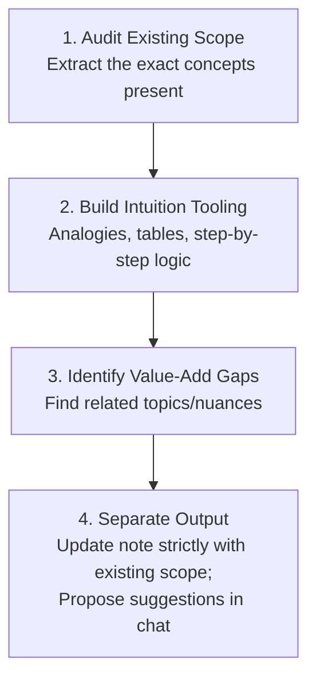

# Intuitive Tech Notes

## Overview

Transform technical notes into clear, highly intuitive study guides using vivid mental models, structured comparisons, and visual diagrams—while **strictly preserving the scope** of the original text.

> [!IMPORTANT]
> **The Scope Preservation Rule:**
> Never silently inject new technical topics, extra primitives, or external concepts directly into the note. Only explain, clarify, and visualize what the user already wrote. If you identify missing nuances or related topics that would add value, **suggest them in chat or ask the user first**.

---

## The 4-Step Refinement Process

### Step 1: Audit Existing Scope

- Read the note and list the explicit concepts, definitions, and code already present.
- Establish the boundary: **Nothing outside this list goes into the note edits.**

### Step 2: Build Intuition (For Existing Concepts Only)

Make the concepts click by applying the **Intuition Toolkit**:

1. **Real-World Mental Models & Analogies**:
   - Ground abstract code/hardware mechanisms in concrete physical metaphors (e.g., flag grabbing, ticket dispensers, whiteboard checks, bank vault vs. bolt).
2. **Side-by-Side Comparison Tables**:
   - Answer: *Who provides it? Where does it run? What happens on contention? How fast is it?*
   - Demystify confusingly similar concepts (e.g., Hardware Primitives vs. Mutex vs. Semaphore).
3. **The "Why Normal Code Fails" Contrast**:
   - Walk through the exact race condition or interleaving that breaks naive code, making the necessity of the concept immediately obvious.
4. **Annotated Execution Walkthrough**:
   - Take the user's pseudo-code or algorithms and annotate line-by-line explaining *what* happens and *why* it is designed that way.
5. **Top-Down Mermaid Flowcharts (`flowchart TD`)**:
   - Visualize execution flow vertically so it renders fully in Obsidian without horizontal clipping.

### Step 3: Identify Value-Add Gaps

While reviewing, note down:

- Missing edge cases (e.g., the ABA problem in CAS).
- Related hardware/OS concepts (e.g., Memory Barriers, Cache Coherence).
- Concrete latency figures or rules of thumb (e.g., spin vs. sleep trade-offs).
- Common interview follow-up questions.

### Step 4: Separate Output (Note vs. Chat)

- **In the Note**: Write only the refined, intuitive explanations of the **existing** content.
- **In the Chat Response**: Present your suggestions clearly and ask the user if they wish to add any of them:
  > *"I noticed that concept X is closely tied to Y (e.g., Memory Barriers / ABA Problem). Would adding a short section on Y add value to your notes?"*

---

## The Intuition Toolkit: Before vs. After

### Pattern 1: Abstract Definition $\to$ Concrete Mental Model

- ❌ **Before (Abstract / Textual):**
  > `Test-and-Set`: A common atomic primitive used to check and update a value as one operation.
- ✅ **After (Intuitive Mental Model):**
  > **Test-and-Set (The "Flag Grabbing" Metaphor):**
  > Imagine a table with a flag. You run in, grab whatever is there, and leave a `1` (busy flag) in its place:
  > - If you picked up `0` (free): You were first! You now own the room.
  > - If you picked up `1` (busy): Someone was already inside. You put back `1` and must wait.
  > The check and the grab happen in a single, un-interruptible hardware step.

### Pattern 2: Vague Distinction $\to$ Multi-Dimension Matrix

- ❌ **Before:**
  > Mutexes are mutual exclusion locks. Semaphores are higher-level primitives. Hardware primitives are the foundation.
- ✅ **After (Structured Comparison):**

| Dimension | Atomic Hardware Primitive | Mutex (Mutual Exclusion) | Semaphore |
| :--- | :--- | :--- | :--- |
| **Provided By** | CPU Silicon (Hardware) | OS Kernel & Thread Library | OS Kernel & Thread Library |
| **Scope** | Single memory word (32/64-bit int) | Entire critical section | Pool of $N$ shared resources |
| **Execution Time** | ~1 nanosecond (1 clock cycle) | Nanoseconds to Microseconds | Microseconds |
| **On Contention** | Spins / Retries (Cannot sleep) | Puts thread to sleep via OS scheduler | Puts thread to sleep if count $\le 0$ |
| **Ownership** | No concept of thread ownership | Strict (Only locker can unlock) | No ownership (Any thread can signal) |

---

## Formatting & Repository Standards

When editing notes in this repository, you **MUST** adhere to:

1. **Heading Hierarchy**: Always start headings at `##` (never `#`). Subheadings use `###` and `####`.
2. **Obsidian & Quartz Compatibility**:
   - Wrap 2D array outputs or bracketed numbers in backticks (e.g., `` `[[-2, 1]]` ``) so Quartz does not interpret them as broken wikilinks.
   - Blank lines around all lists, headings, tables, and fenced code blocks.
3. **Mermaid Guidelines for Obsidian**:
   - Always prefer vertical layouts: `flowchart TD` (avoid wide horizontal `flowchart LR` or wide `sequenceDiagram` with >3 participants which clip in Obsidian).
   - Quote **every** node label and edge label containing special characters (`:`, `?`, `/`, `+`, `(`, `)`):
     `Node["Label (Info)"]`, `| "Yes: Proceed" |`.
   - Never use raw ` ` HTML tags inside labels.
4. **Verification**:
   - Always run `npm run lint` (`lint:md` and `lint:notes`) to verify zero markdownlint issues.
   - Always verify `npm run test:links` to ensure zero broken links.

---

## Common Rationalizations & Red Flags

| Rationalization / Excuse | Why It Violates the Skill | Required Action |
| :--- | :--- | :--- |
| *"This extra technical detail is so important, I'll just write it directly into the note."* | Violates the **Scope Preservation Rule**. The user explicitly asked not to expand the note unilaterally. | Keep the note focused. Suggest the extra topic in chat and ask for approval first. |
| *"The note is short, so I need to add 5 new sections to make it complete."* | Length $\ne$ Quality. The goal is to make existing content click intuitively, not bloat the note. | Use analogies, tables, and flowcharts on existing topics. |
| *"A sequence diagram looks cooler than a flowchart."* | Wide sequence diagrams clip horizontally in Obsidian's standard pane width. | Use `flowchart TD` with quoted labels. |

