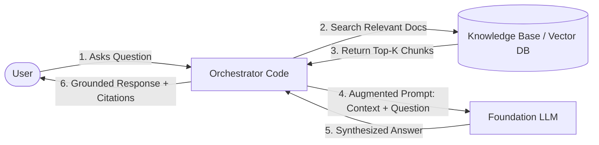
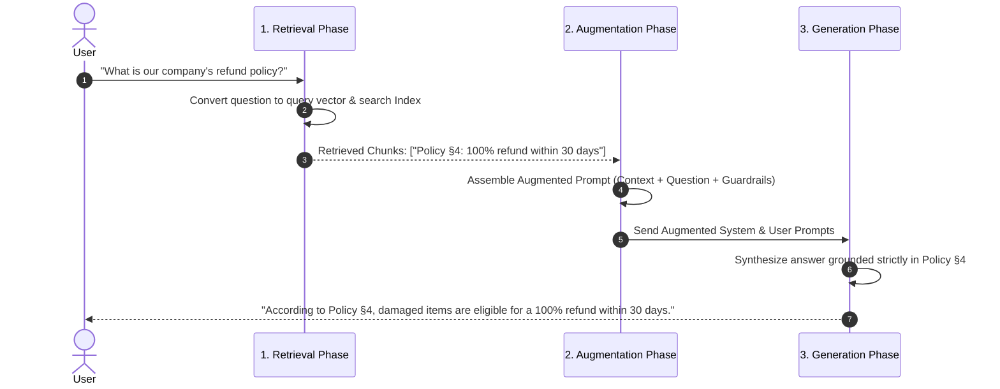

## What is RAG (Retrieval-Augmented Generation)?

1. **Retrieval-Augmented Generation (RAG)** is an architectural pattern that optimizes the output of a Large Language Model by referencing an authoritative, external knowledge base outside its pre-training data before generating a response.
2. Rather than relying solely on parametric memory (weights learned during training), RAG retrieves relevant facts from non-parametric external memory (documents, databases, vector stores) and injects them directly into the prompt context at inference time:
	$$\text{RAG} = \text{Retrieval (Search)} + \text{Augmentation (Context Injection)} + \text{Generation (Synthesis)}$$

---

## Why RAG Is Essential

Foundation models are powerful general reasoners, but they suffer from three fundamental constraints:

1. **Static Training Cutoffs**: Once pre-training concludes, a model's internal weights contain no knowledge of newly published information, breaking events, or updated policies.
2. **Hallucination Risk**: When queried on obscure, domain-specific, or proprietary facts, models frequently fabricate plausible-sounding but completely incorrect statements.
3. **Enterprise Privacy & Security**: Proprietary company documents (internal wikis, customer CRM records, private codebases, HR dossiers) cannot be exposed during public model training.
4. **Auditability & Provenance**: RAG provides citations back to source documents, enabling users to verify assertions against exact passages in the knowledge base.

---

## The Four Core Components of RAG

1. **Chat Interface**: The user-facing conversational entry point (e.g., Gradio, React web app, mobile client).
2. **Orchestration Layer**: The application glue code responsible for receiving user queries, managing state, executing vector searches, formatting prompts, and invoking models.
3. **Knowledge Base / Index**: The external repository containing domain documents, structured data, or a vector store (e.g., ChromaDB, Qdrant, Pinecone).
4. **Foundation LLM**: The generative inference engine (e.g., GPT-4o, Llama 3, Claude 3.5 Sonnet) that reads the injected facts and synthesizes a grounded answer.

---

## The Three Phases of RAG

1. **Retrieval**:
	- The user's query is converted into a search vector (or hybrid keyword query) and matched against the knowledge base to extract the top-$k$ most relevant text chunks.
2. **Augmentation**:
	- The retrieved text passages are structured into an augmented prompt alongside system instructions (e.g., *"Answer strictly based on the context provided; if unknown, say so"*).
3. **Generation**:
	- The LLM processes the augmented prompt and generates a natural-language answer grounded in the retrieved evidence, including source citations.

---

## RAG vs. Fine-Tuning vs. Prompt Engineering

Choosing the correct technique depends on whether the goal is teaching the model **new knowledge** or adjusting its **style, format, or task behavior**:

| Feature / Dimension | Prompt Engineering | Retrieval-Augmented Generation (RAG) | Fine-Tuning (SFT / PEFT) |
| --- | --- | --- | --- |
| **Primary Purpose** | Guiding behavior, few-shot demonstration | Supplying dynamic, external factual knowledge | Customizing style, tone, syntax, or niche vocabulary |
| **Knowledge Currency** | Static (within context window limits) | **Real-Time / Dynamic**: Update vector DB instantly without retraining | **Static**: Locked to fine-tuning dataset cutoff date |
| **Hallucination Control** | Low to moderate | **High**: Grounded strictly in retrieved source passages | Moderate: Model can still hallucinate ungrounded facts |
| **Source Provenance / Citations** | None | **Direct**: Can point to exact files, page numbers, or URLs | None: Knowledge is diffuse across model weights |
| **Cost & Latency** | Lowest cost; zero training overhead | Low setup cost; incurs search retrieval latency | High training compute costs; low inference latency |
| **Data Requirements** | Few examples | Unstructured documents (markdown, PDF, HTML) | Hundreds to thousands of high-quality paired input-output examples |

---

## When to Use RAG (and When Not To)

### Ideal Scenarios for RAG

1. **Dynamic, Rapidly Changing Information**: Product catalogs, inventory levels, daily company memos, legal regulatory updates.
2. **Massive External Knowledge Repositories**: Thousands of pages of technical documentation, codebases, or customer knowledge bases that exceed LLM context windows.
3. **Strict Compliance & Verification**: Scenarios where every assertion must be traceable to an authoritative source (legal, healthcare, financial audit).

### When RAG Is the Wrong Tool

1. **Tone or Stylistic Adaptation**: If the objective is to make an LLM write in Shakespearean English or strictly follow a proprietary JSON dialect, **Fine-Tuning** or **Few-Shot Prompting** is more appropriate.
2. **Static General Knowledge**: If querying well-established universal facts (e.g., *"What is the capital of France?"*), the pre-trained weights are already sufficient.
3. **Ultra-Low Latency Classifications**: If classifying sentiment or intent under a strict 10ms deadline, a lightweight fine-tuned classifier (e.g., DistilBERT) is far faster than a multi-stage RAG pipeline.
