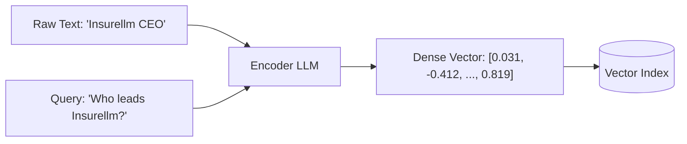

## What Are Vector Embeddings?

1. A **vector embedding** is a dense numerical array of floating-point numbers that captures the semantic meaning, context, and relationships of text in a high-dimensional continuous latent space.
2. Rather than treating words as arbitrary atomic symbols or static IDs, embeddings map semantically similar sentences or concepts to geometrically close coordinates.

---

## Limitations of Naive Keyword Matching

In early RAG experiments, systems attempted naive string matching (e.g., matching query terms against document dictionaries):

1. **Synonym Blindness**: A query asking for *"reinsurance software"* fails to retrieve a document titled *"Rellm Enterprise Platform"* because the exact word *"software"* never appears in the title.
2. **Spelling & Typo Sensitivity**: Searching for *"Averi Lancaster"* yields zero hits when the file is named *"Avery Lancaster"*.
3. **Morphological Variations**: Queries using different tenses, plurals, or conjugations (*"claims"* vs. *"claim"*, *"adjusting"* vs. *"adjuster"*) fail without complex stemming and lemmatization rules.
4. **Lack of Contextual Intent**: Keyword lookups cannot distinguish between *"bank of the river"* and *"commercial investment bank"*.

---

## Auto-Encoding vs. Auto-Regressive Models

Embedding models rely on **Auto-Encoding** architectures, while conversational generators rely on **Auto-Regressive** architectures:

| Feature | Auto-Encoding Models (Encoders) | Auto-Regressive Models (Decoders) |
| --- | --- | --- |
| **Foundational Models** | BERT, RoBERTa, DeBERTa, BGE, `all-MiniLM-L6-v2` | GPT-4, Llama 3, Mistral, Claude |
| **Attention Architecture** | **Bidirectional**: Every token attends to both preceding and succeeding tokens simultaneously | **Causal / Masked**: Tokens can only attend to previous tokens in the sequence |
| **Training Objective** | Masked Language Modeling (MLM): Predict intentionally masked tokens within a sentence | Next-token prediction: Predict token $t_{n+1}$ given preceding context $t_1 \dots t_n$ |
| **Output Representation** | High-dimensional dense vector representing holistic text semantics | Autoregressively sampled tokens forming human-readable text |
| **Primary Use Cases** | Text classification, search indexing, **vector embeddings** | Creative writing, reasoning, conversational dialogue |

---

## Tokens vs. Vectors

| Dimension | Token | Vector Embedding |
| --- | --- | --- |
| **Definition** | Discrete integer identifier from a fixed vocabulary table | Continuous array of 32-bit floating-point numbers |
| **Format** | Integer (e.g., `4523` for `"insurance"`) | Array of floats (e.g., `[0.024, -0.119, 0.402, ...]`) |
| **Dimensionality** | Scalar ($1 \times 1$) | 384 (`all-MiniLM-L6-v2`), 768 (`BERT`), 1536 (`text-embedding-3-small`), or 3072 (`text-embedding-3-large`) |
| **Semantic Meaning** | None independently; adjacent token IDs have zero geometric or semantic relationship | High semantic density; distance reflects semantic similarity |

---

## Geometry of Embedding Space

1. **Dense Semantic Space**:
	- Pre-trained transformer encoders project text into multi-hundred or multi-thousand dimensional hyperspace.
	- Directions in this space correlate with semantic features (e.g., gender, tense, category, sentiment).
2. **Vector Arithmetic**:
	- Embeddings exhibit linear compositionality:
		$$\vec{v}_{\text{King}} - \vec{v}_{\text{Man}} + \vec{v}_{\text{Woman}} \approx \vec{v}_{\text{Queen}}$$



---

## Mathematical Similarity Metrics

Vector similarity determines how close a user query is to stored document chunks:

| Metric | Formula | Range | Characteristics |
| --- | --- | --- | --- |
| **Cosine Similarity** | $\cos(\theta) = \frac{\mathbf{A} \cdot \mathbf{B}}{\|\mathbf{A}\| \|\mathbf{B}\|}$ | $[-1.0, 1.0]$ | Measures angular orientation regardless of vector magnitude. Standard for normalized text embeddings. |
| **Cosine Distance** | $D_C = 1 - \cos(\theta)$ | $[0.0, 2.0]$ | Distance counterpart to cosine similarity ($0$ means identical orientation). |
| **Euclidean Distance ($L_2$)** | $D_E = \sqrt{\sum_{i=1}^n (A_i - B_i)^2}$ | $[0, \infty)$ | Straight-line distance between two vector endpoints in Euclidean space. |
| **Dot Product** | $\mathbf{A} \cdot \mathbf{B} = \sum_{i=1}^n A_i B_i$ | $(-\infty, \infty)$ | Equivalent to cosine similarity when embeddings are unit-normalized ($\|\mathbf{A}\| = \|\mathbf{B}\| = 1$). Fast to compute. |

---

## Generating Embeddings in Python

```python
from langchain_huggingface import HuggingFaceEmbeddings
from langchain_openai import OpenAIEmbeddings

# 1. Local Open-Source Embedding Model (384 dimensions)
local_embeddings = HuggingFaceEmbeddings(model_name="all-MiniLM-L6-v2")
vector_local = local_embeddings.embed_query("Who is Avery Lancaster?")
print(f"Local embedding dimensions: {len(vector_local)}")  # Output: 384

# 2. Frontier Cloud Embedding Model (3072 dimensions)
cloud_embeddings = OpenAIEmbeddings(model="text-embedding-3-large")
vector_cloud = cloud_embeddings.embed_query("Who is Avery Lancaster?")
print(f"Cloud embedding dimensions: {len(vector_cloud)}")  # Output: 3072
```
