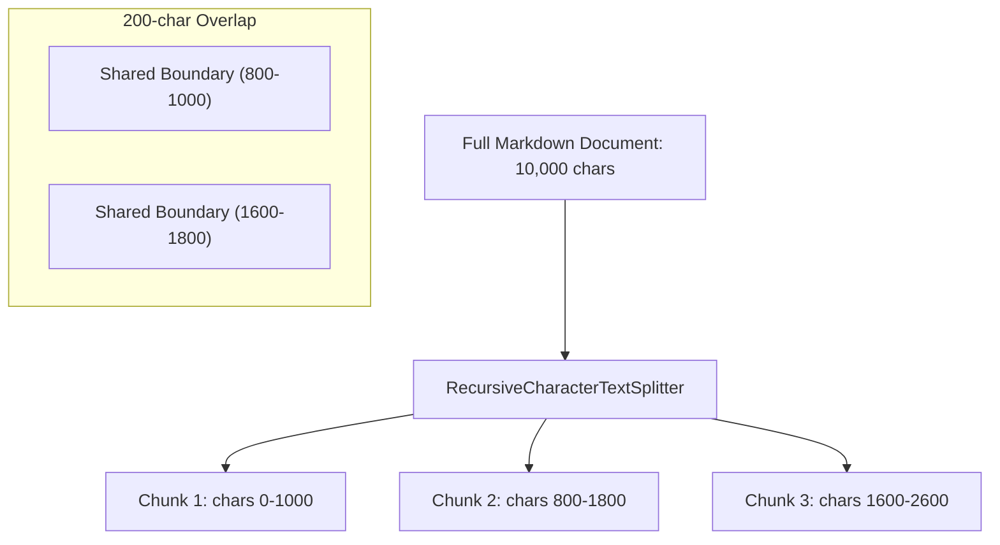

## Why Chunking Is Essential

1. **Context Window Constraints**: While modern LLM context windows have grown, filling them with massive raw files increases latency, cost, and the "lost-in-the-middle" phenomenon.
2. **Semantic Dilution Problem**: Embedding an entire 30-page document produces a single vector that averages out all internal concepts into an unfocused representation. Specific factual details (e.g., a single pricing tier or salary figure) are washed out.
3. **Retrieval Precision**: Breaking documents into small, cohesive passages ensures that the cosine similarity between a targeted question and the exact answer snippet is high.

---

## Document Text Splitting Strategies

### 1. `CharacterTextSplitter`

Splits strictly based on a fixed character count or a single separator (e.g., `"\n\n"`). If a single paragraph exceeds the threshold, it splits mid-sentence, causing fragmented thoughts.

### 2. `RecursiveCharacterTextSplitter`

The recommended standard for natural language. It attempts to split text hierarchically using a sequence of delimiters to preserve semantic paragraphs and sentences:

$$\text{Delimiter Hierarchy: } ["\backslash n\backslash n", "\backslash n", " ", ""]$$

1. First, it tries to split on double line breaks (`\n\n`) to preserve distinct paragraphs.
2. If a paragraph is still larger than `chunk_size`, it splits on single line breaks (`\n`) to preserve lines.
3. If still too large, it splits on spaces (` `) to preserve words.
4. As a last resort, it splits on individual characters (`""`).

---

## Chunk Size and Overlap Trade-Offs

- `chunk_size`: Maximum number of characters (or tokens) contained in a single chunk.
- `chunk_overlap`: Number of characters shared between consecutive chunks. Prevents critical facts from being split across chunk boundaries.

| Chunk Size | Retrieval Precision | Context Completeness | Risk / Downside | Typical Use Case |
| --- | --- | --- | --- | --- |
| **Small (100–300 chars)** | Very High | Low | Misses surrounding context needed to understand the fact | Direct entity extraction, FAQ matching |
| **Medium (800–1200 chars)** | High | High | Balanced sweet spot | General technical documentation, corporate policies |
| **Large (2000+ chars)** | Low | Very High | Irrelevant sentences dilute vector similarity; higher token costs | Long narrative synthesis, legal contracts |



---

## Document Ingestion and Chunking in LangChain

```python
import glob
import os
from langchain_community.document_loaders import DirectoryLoader, TextLoader
from langchain_text_splitters import RecursiveCharacterTextSplitter

# 1. Load documents and attach category metadata
folders = glob.glob("knowledge-base/*")
documents = []
for folder in folders:
    doc_type = os.path.basename(folder)
    loader = DirectoryLoader(
        folder,
        glob="**/*.md",
        loader_cls=TextLoader,
        loader_kwargs={"encoding": "utf-8"},
    )
    for doc in loader.load():
        doc.metadata["doc_type"] = doc_type
        documents.append(doc)

# 2. Split documents into overlapping chunks
text_splitter = RecursiveCharacterTextSplitter(chunk_size=1000, chunk_overlap=200)
chunks = text_splitter.split_documents(documents)
print(f"Loaded {len(documents)} documents into {len(chunks)} chunks.")
```

---

## Vector Databases: ChromaDB

A **Vector Database** is an indexing system optimized to store high-dimensional vectors and perform sub-linear approximate nearest neighbor (ANN) searches across millions of embeddings.

### Why ChromaDB?

1. **Lightweight & Embedded**: Runs directly in Python memory or saves locally to disk without spinning up an external server container.
2. **Built-in Storage**: Manages vector embeddings, raw text, and structured key-value metadata in one coordinated store.
3. **Persistence**: Saves collections locally via `persist_directory` or native `chromadb.PersistentClient`.

```python
from langchain_chroma import Chroma
from langchain_huggingface import HuggingFaceEmbeddings

# Initialize embedding model
embeddings = HuggingFaceEmbeddings(model_name="all-MiniLM-L6-v2")

# Create and persist Chroma vector store
vectorstore = Chroma.from_documents(
    documents=chunks, embedding=embeddings, persist_directory="vector_db"
)

# Inspect stored collection
collection = vectorstore._collection
print(f"Stored {collection.count()} vectors of dimension {len(collection.get(limit=1, include=['embeddings'])['embeddings'][0])}")
```

---

## Visualizing Embeddings with t-SNE

1. **The Curse of Dimensionality**:
	- Humans cannot visualize 384-dimensional or 3072-dimensional spaces directly.
2. **t-SNE (t-Distributed Stochastic Neighbor Embedding)**:
	- A non-linear dimensionality reduction technique designed specifically for visualizing high-dimensional datasets.
	- Converts affinities between data points to probabilities, mapping high-dimensional vectors to 2D or 3D coordinates while preserving local neighborhood clusters.

```python
import numpy as np
import plotly.graph_objects as go
from sklearn.manifold import TSNE

# 1. Extract vectors and document types from Chroma
result = collection.get(include=["embeddings", "documents", "metadatas"])
vectors = np.array(result["embeddings"])
doc_types = [m["doc_type"] for m in result["metadatas"]]

# 2. Reduce 384 dimensions to 2D
tsne = TSNE(n_components=2, random_state=42, perplexity=30)
reduced_vectors = tsne.fit_transform(vectors)

# 3. Interactive visualization with Plotly
fig = go.Figure(
    data=[
        go.Scatter(
            x=reduced_vectors[:, 0],
            y=reduced_vectors[:, 1],
            mode="markers",
            marker=dict(size=6, opacity=0.8),
            text=doc_types,
            hoverinfo="text",
        )
    ]
)
fig.update_layout(title="2D t-SNE Projection of Knowledge Base Vectors")
fig.show()
```

3. **Key Visual Insights**:
	- Documents discussing related products (e.g., `Claimllm` and `Policyllm`) cluster tightly in the same manifold.
	- Employee HR dossiers occupy a distinct, separated cluster, demonstrating that dense embeddings successfully capture topic boundaries without explicit classification labels.
