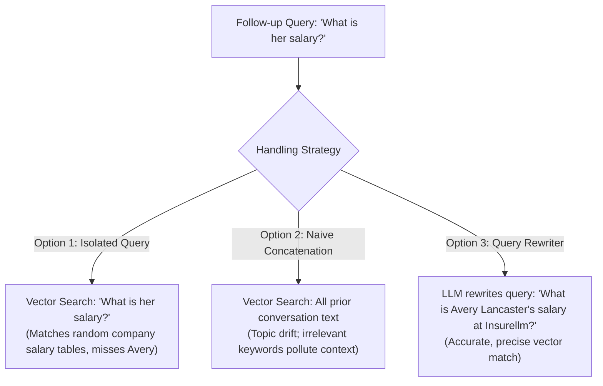

## Core LangChain Abstractions: `LLM` vs `Retriever`

Modern LLM frameworks organize RAG components around standard runnable interfaces where every component implements `.invoke()`:

1. **Retriever**:
	- **Input**: A natural language string (e.g., `"Who is Avery?"`).
	- **Output**: A list of relevant `Document` objects containing `page_content` and `metadata`.
	- **Responsibility**: Searches the vector store or index for matching chunks without generating new text.
2. **LLM**:
	- **Input**: A list of structured messages (`SystemMessage`, `HumanMessage`, `AIMessage`).
	- **Output**: An `AIMessage` containing synthesized text.
	- **Responsibility**: Reasons over the provided prompt and context to construct a response.

---

## The Hallucination Isolation Experiment

To observe why the retriever is critical, compare running the LLM in isolation versus running it with retrieval augmentation:

```python
from langchain_chroma import Chroma
from langchain_huggingface import HuggingFaceEmbeddings
from langchain_ollama import ChatOllama

embeddings = HuggingFaceEmbeddings(model_name="all-MiniLM-L6-v2")
vectorstore = Chroma(persist_directory="vector_db", embedding_function=embeddings)

retriever = vectorstore.as_retriever()
llm = ChatOllama(model="llama3.2", temperature=0)

# Test 1: Querying LLM directly without external context
raw_response = llm.invoke("Who is Avery?")
# Result: Severe hallucination. The LLM guesses public celebrities:
# "Avery Brooks (Star Trek actor), Avery Whitted (poker player)..."

# Test 2: Querying Retriever directly
docs = retriever.invoke("Who is Avery?")
# Result: Retrieves 4 grounded chunks from 'Avery Lancaster.md':
# "Avery Lancaster is Co-Founder & CEO of Insurellm..."
```

---

## The Mechanics of Model Temperature

| Temperature Setting | Sampling Mechanism | Behavior | Ideal Use Case |
| --- | --- | --- | --- |
| **`temperature = 0`** | **Greedy Decoding**: Always selects the token with the highest logit probability | Deterministic, focused, factual | RAG question answering, code generation, entity extraction |
| **`temperature = 0.7`** | **Softened Distribution**: Flattens the probability curve so lower-ranked tokens have a chance | Balanced variety and coherence | General conversation, drafting assistance |
| **`temperature = 1.2+`** | **High Entropy**: Dramatically raises probabilities of rare tokens | Unpredictable, random, chaotic | Brainstorming, experimental creative fiction |

> [!NOTE]
> A temperature of `0` does **not** guarantee 100% bitwise reproducibility on modern GPUs due to floating-point non-associativity across parallel execution warps. Pinning a random seed is also required, and system behavior can still exhibit slight variance.
> For true domain-specific creativity, customize the **System Prompt** rather than raising temperature.

---

## Assembling the End-to-End Pipeline in Gradio

```python
import gradio as gr
from langchain_core.messages import HumanMessage, SystemMessage

SYSTEM_PROMPT_TEMPLATE = """
You are a knowledgeable, friendly assistant representing the company Insurellm.
You are chatting with a user about Insurellm.
If relevant, use the given context to answer any question.
If you don't know the answer, say so.

Context:
{context}
"""


def answer_question(question: str, history: list) -> str:
    # 1. Retrieve relevant chunks
    docs = retriever.invoke(question)
    context = "\n\n".join(doc.page_content for doc in docs)

    # 2. Augment prompt
    system_prompt = SYSTEM_PROMPT_TEMPLATE.format(context=context)
    messages = [
        SystemMessage(content=system_prompt),
        HumanMessage(content=question),
    ]

    # 3. Generate grounded answer
    response = llm.invoke(messages)
    return response.content


# Launch interactive Gradio chat interface
gr.ChatInterface(answer_question).launch()
```

---

## Context Management in Multi-Turn Conversations

In multi-turn chatbots, managing conversation state presents a dual challenge:



### The Chat History Dilemma

1. **Isolated Query Mode (Omit History)**:
	- Fails on pronouns and elliptical references (e.g., *"How much does she earn?"* or *"What did they launch in 2023?"*). The vector search has no idea who "she" refers to.
2. **Naive Concatenation Mode (Append Everything)**:
	- Appending all prior user and assistant turns creates noisy search queries. If the conversation shifts topics, older keywords continue retrieving irrelevant chunks, diluting the prompt context.

### The Solution: Conversational Query Rewriting

Before searching the vector database, pass the user's latest query and the conversation history to a fast LLM to synthesize a **standalone search query**:

```python
def rewrite_query(question: str, history: list[dict]) -> str:
    history_text = "\n".join(f"{m['role']}: {m['content']}" for m in history)
    prompt = f"""
Given the following conversation history and the user's latest question,
rephrase the question into a standalone search query that contains all necessary context
needed to search a knowledge base. Do NOT answer the question, only rephrase it.

Conversation History:
{history_text}

Latest Question: {question}

Standalone Query:"""

    response = llm.invoke([HumanMessage(content=prompt)])
    return response.content.strip()
```
