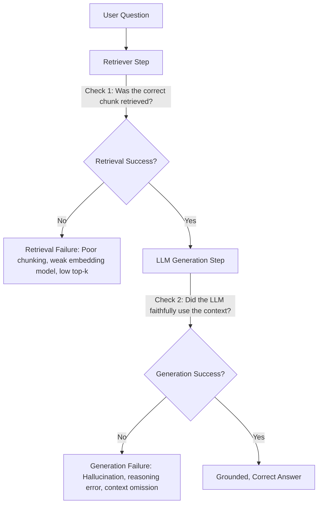

## Why RAG Systems Require Formal Evaluation

Building a simple RAG demo is straightforward, but deploying it reliably to production is difficult. Without automated, quantitative evaluations:

1. Changes to chunk sizes, embedding models, or prompts cannot be measured for regressions.
2. System failures occur silently, causing subtle hallucinations or missing key facts.
3. Teams cannot isolate whether an incorrect response stems from poor search or flawed generation.

---

## The Two Failure Modes of RAG



1. **Retrieval Failure**: The vector database fails to locate the relevant document chunks in its top-$k$ results. The generative LLM cannot answer correctly because the necessary facts are missing from its prompt.
2. **Generation Failure**: The retriever successfully fetches the required facts, but the generative model hallucinates, misinterprets the context, or omits critical details.

---

## The Golden Evaluation Dataset

A production evaluation pipeline requires a **Golden Dataset** containing curated test cases, ground-truth reference answers, and mandatory verification keywords:

```json
{
  "question": "Who won the prestigious IIOTY award in 2023?",
  "category": "direct_fact",
  "reference_answer": "Maxine Thompson won the prestigious Insurellm Innovator of the Year (IIOTY) award in 2023.",
  "keywords": ["Maxine", "Thompson", "IIOTY"]
}
```

### The 7 Core Question Archetypes

| Category | Description | Challenge for RAG |
| --- | --- | --- |
| **`direct_fact`** | Simple, single-hop factual query (e.g., *"What is Alex's title?"*) | Requires high precision in top-$k$ ranks |
| **`temporal`** | Time-sensitive queries (e.g., *"What was Avery's rating in 2021 vs 2022?"*) | Disambiguating chronological updates |
| **`spanning`** | Facts distributed across multiple separate documents or sections | High recall across different chunks |
| **`comparative`** | Comparing features or pricing between two different products | Simultaneous retrieval of multiple distinct entities |
| **`numerical`** | Calculating limits, pricing tiers, or date differences | Context completeness for mathematical reasoning |
| **`relationship`** | Entity relationships (e.g., manager, mentor, report structures) | Preserving entity association graph |
| **`holistic`** | Broad overview queries (e.g., *"Summarize Insurellm's product suite"*) | Avoiding context fragmentation |

---

## Quantitative Retrieval Metrics

```python
import math


def calculate_mrr(keyword: str, retrieved_docs: list) -> float:
    keyword_lower = keyword.lower()
    for rank, doc in enumerate(retrieved_docs, start=1):
        if keyword_lower in doc.page_content.lower():
            return 1.0 / rank
    return 0.0


def calculate_dcg(relevances: list[int], k: int) -> float:
    dcg = 0.0
    for i in range(min(k, len(relevances))):
        dcg += relevances[i] / math.log2(i + 2)
    return dcg
```

### 1. Mean Reciprocal Rank (MRR)

Evaluates how close to the top of the list the **first** relevant chunk appears:

$$\text{RR} = \frac{1}{\text{rank}_{\text{first}}}$$

- If the first chunk containing the keyword is at **Rank 1**, $\text{RR} = 1.0$.
- If at **Rank 2**, $\text{RR} = 0.5$.
- If at **Rank 4**, $\text{RR} = 0.25$.
- If the keyword is missing from all top-$k$ chunks, $\text{RR} = 0.0$.

### 2. Normalized Discounted Cumulative Gain (nDCG)

Evaluates the **entire** ranked list, placing higher value on relevant documents appearing earlier:

$$\text{DCG}_k = \sum_{i=1}^k \frac{\text{rel}_i}{\log_2(i + 1)}, \quad \text{nDCG}_k = \frac{\text{DCG}_k}{\text{IDCG}_k}$$

- $\text{rel}_i$: Binary ($1$ or $0$) or graded relevance score at rank $i$.
- $\text{IDCG}_k$: Ideal DCG, representing the theoretical maximum score if all relevant chunks were at the very top.
- Normalizes scores between $0.0$ and $1.0$.

### 3. Keyword Coverage (Recall@K)

Percentage of mandatory reference keywords present anywhere across the top-$k$ retrieved chunks:

$$\text{Keyword Coverage} = \frac{\text{Keywords Found in Top-}k}{\text{Total Expected Keywords}} \times 100\%$$

---

## Qualitative Answer Evaluation: LLM-as-a-Judge

Traditional automated metrics like BLEU and ROUGE evaluate surface-level n-gram overlap. They fail in RAG evaluation because an answer can have high n-gram overlap while being factually wrong, or low overlap while being completely accurate.

Instead, a secondary judge LLM evaluates the generated response against the ground-truth reference answer across **three primary dimensions** using **Pydantic** structured schemas:

```python
from pydantic import BaseModel, Field


class AnswerEval(BaseModel):
    feedback: str = Field(
        description="Detailed feedback comparing generated to reference answer"
    )
    accuracy: float = Field(
        description="Factual correctness: 1 (wrong) to 5 (ideal). Any factual error must receive 1."
    )
    completeness: float = Field(
        description="Coverage of reference facts: 1 (poor) to 5 (ideal). All aspects must be covered for 5."
    )
    relevance: float = Field(
        description="Directness to question: 1 (off-topic) to 5 (ideal). Penalize unnecessary fluff."
    )
```

```python
from litellm import completion

judge_messages = [
    {
        "role": "system",
        "content": "You are an expert evaluator assessing answer quality against a reference answer.",
    },
    {
        "role": "user",
        "content": f"""Question: {test.question}
Generated Answer: {generated_answer}
Reference Answer: {test.reference_answer}

Evaluate on accuracy, completeness, and relevance from 1 to 5.""",
    },
]

response = completion(
    model="gpt-4.1-nano",
    messages=judge_messages,
    response_format=AnswerEval,
)
evaluation = AnswerEval.model_validate_json(
    response.choices[0].message.content
)
print(
    f"Accuracy: {evaluation.accuracy}, Completeness: {evaluation.completeness}, Relevance: {evaluation.relevance}"
)
```

---

## Hyperparameter Tuning Insights

Systematically tuning parameters produces measurable trade-offs across retrieval and answer metrics:

| Parameter | Increase Effect | Decrease Effect | Sweet Spot |
| --- | --- | --- | --- |
| **`chunk_size`** | Boosts context completeness; lowers MRR and search precision | Boosts MRR for direct lookups; risks missing multi-sentence facts | 500–1000 characters |
| **`chunk_overlap`** | Prevents boundary loss; increases index size and redundancy | Reduces storage and duplication; risks splitting entities | 10%–25% (100–200 chars) |
| **`top_k`** | Maximizes recall/keyword coverage; introduces context noise for generator | Reduces LLM token costs and noise; risks omitting facts | $k = 4$ to $10$ (or $k=20$ before re-ranking) |
| **Embedding Model** | Higher dimensionality (`3072D`) yields significantly higher nDCG | Lower dimensionality (`384D`) runs fast locally on CPU | Production: `text-embedding-3-large` or `bge-large` |
