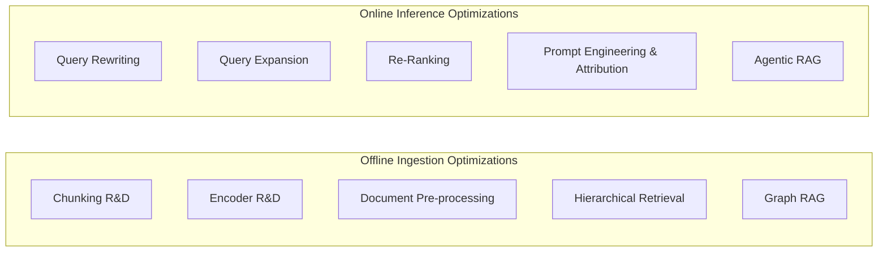
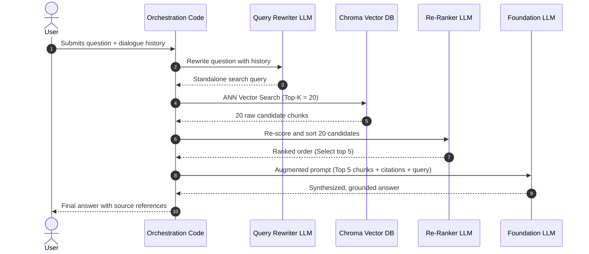

## The 10 Advanced RAG Techniques

Beyond basic chunking and vector lookups, production RAG systems employ specialized techniques across ingestion, retrieval, and generation:



| # | Technique | Description | Practical Benefit |
| --- | --- | --- | --- |
| **1** | **Chunking R&D** | Tailoring chunking logic to document types (Markdown headers, HTML tables, code ASTs) | Preserves semantic tables and structural relationships |
| **2** | **Encoder R&D** | Selecting and fine-tuning domain-specific encoders (e.g., medical, financial, or multilingual) | Maximizes retrieval nDCG on specialized vocabulary |
| **3** | **Prompt Improvement** | Enforcing strict system instructions, negative rejection, date context, and citation rules | Drastically curtails hallucinations |
| **4** | **Document Pre-processing** | Using an LLM during offline ingestion to generate synthetic headlines, summaries, and FAQs | Generates high-similarity vectors matching user queries |
| **5** | **Query Rewriting** | Reformulating conversational questions into standalone search queries | Resolves ambiguous pronouns and chat context |
| **6** | **Query Expansion** | Generating 3–5 multi-perspective queries from a single user prompt | Overcomes vocabulary mismatches across documents |
| **7** | **Re-Ranking** | Retrieving a wide candidate set ($k=20$) and re-sorting via cross-encoder or LLM | Eliminates irrelevant chunks; puts best facts at rank 1 |
| **8** | **Hierarchical Retrieval** | Indexing small sentence chunks for search, but returning parent paragraphs to the LLM | Combines high search precision with broad context |
| **9** | **Graph RAG** | Extracting entity-relation knowledge graphs to traverse linked facts | Answers complex multi-hop queries spanning distinct documents |
| **10** | **Agentic RAG** | Autonomous routing agents with tool-calling, multi-step search loops, and verification | Dynamically routes queries across multiple data sources |

---

## Building a Pure-Python Production Pipeline (Without LangChain)

Removing heavyweight framework wrappers provides direct control over data transformations, lower execution latency, and transparent error handling.

### 1. Structured Document Pre-Processing

During offline ingestion, an LLM parses each document and outputs structured Pydantic chunks containing a search headline, a summary, and the original text:

```python
from pydantic import BaseModel, Field


class Chunk(BaseModel):
    headline: str = Field(
        description="Brief heading most likely to be surfaced in a query"
    )
    summary: str = Field(
        description="Few sentences summarizing content to answer common questions"
    )
    original_text: str = Field(description="Exact original text from document")

    def format_content(self) -> str:
        return f"{self.headline}\n\n{self.summary}\n\n{self.original_text}"


class Chunks(BaseModel):
    chunks: list[Chunk]
```

### 2. Native Chroma Database Storage

Using `chromadb.PersistentClient` directly eliminates third-party abstractions:

```python
import chromadb

chroma = chromadb.PersistentClient(path="preprocessed_db")
collection = chroma.get_or_create_collection("docs")

# Add embeddings and structured metadata directly
collection.add(
    ids=[str(i) for i in range(len(chunks))],
    embeddings=vectors,
    documents=[chunk.format_content() for chunk in chunks],
    metadatas=[chunk.metadata for chunk in chunks],
)
```

### 3. Conversational Query Rewriting

Converts multi-turn conversation history into a concise, focused search query:

```python
from litellm import completion


def rewrite_query(question: str, history: list[dict] = []) -> str:
    prompt = f"""
You are answering questions about the company Insurellm.
Conversation history:
{history}

Current question:
{question}

Respond ONLY with a very short, specific question optimized to search the Knowledge Base.
Do NOT mention the company name unless it is a general inquiry.
"""
    response = completion(
        model="gpt-4.1-nano",
        messages=[{"role": "system", "content": prompt}],
    )
    return response.choices[0].message.content.strip()
```

### 4. LLM Re-Ranking (Cross-Encoding)

Retrieves a wide candidate set ($k=20$) and uses an LLM to re-rank chunks in descending order of true relevance:

```python
class RankOrder(BaseModel):
    order: list[int] = Field(
        description="Ordered list of chunk IDs from most to least relevant"
    )


def rerank(question: str, candidate_chunks: list) -> list:
    system_prompt = (
        "You are an expert document re-ranker. Rank order the provided chunks "
        "by relevance to the user's question. Reply ONLY with the ordered chunk IDs."
    )
    user_prompt = f"Question: {question}\n\n"
    for idx, chunk in enumerate(candidate_chunks, start=1):
        user_prompt += f"# CHUNK ID {idx}:\n{chunk.page_content}\n\n"

    response = completion(
        model="gpt-4.1-nano",
        messages=[
            {"role": "system", "content": system_prompt},
            {"role": "user", "content": user_prompt},
        ],
        response_format=RankOrder,
    )
    order = RankOrder.model_validate_json(response.choices[0].message.content).order
    return [candidate_chunks[i - 1] for i in order]
```

---

## End-to-End Query Execution Flow



---

## Architecture Comparison: Basic RAG vs. Advanced Production RAG

| Dimension | Basic RAG (Day 1–3) | Advanced Production RAG (Day 5) |
| --- | --- | --- |
| **Ingestion** | Blind fixed-length character splitting | LLM-assisted semantic chunking with headlines and summaries |
| **Search Index** | Unmodified text vectors | Vector DB with structured metadata and source attribution |
| **Query Processing** | Raw user string passed directly to search | Multi-turn query rewriting to resolve pronouns and context |
| **Retrieval Depth** | Fixed top-$k$ (e.g., $k=4$) | Wide candidate retrieval ($k=20$) + Cross-Encoder / LLM re-ranking down to top 5 |
| **Prompt Engineering** | Simple string concatenation template | Dynamic context assembly with explicit attribution (`Extract from <source>`) and negative rejection |
| **Frameworks** | Heavy orchestration abstractions | Pure Python, direct client SDKs, Pydantic data schemas |
| **Verification** | Anecdotal spot-checks | Automated benchmark suite (`MRR`, `nDCG`, `LLM-as-a-Judge`) |
