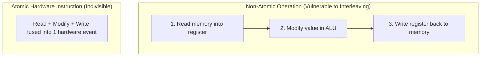
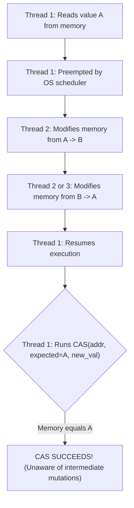
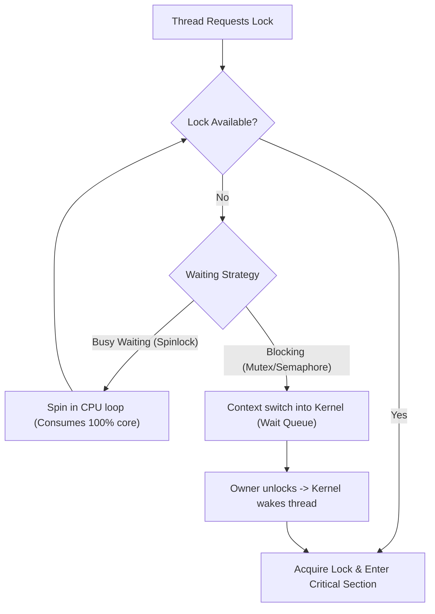

## Why Hardware Synchronization Exists

1. **Theoretical Software Flaws**: Pure software-only synchronization algorithms (such as [[3_Dekkers Algorithm]] or [[4_Petersons Algorithm]]) assume strict sequential memory consistency.
2. **Modern Hardware Reality**:
   - **Compiler Optimization**: Compilers reorder instructions and cache shared variables in CPU registers to maximize execution speed.
   - **Out-of-Order Execution**: Modern multi-core processors speculatively reorder memory loads and stores across cache hierarchies and store buffers.
   - **Cache Incoherency**: Updates made on one CPU core are not immediately visible to other cores without hardware coordination.
3. **The Solution**: Hardware provides **atomic instructions**—indivisible operations guaranteed by CPU silicon that cannot be interleaved or partially observed by other cores.

---

## Atomicity & The Read-Modify-Write (RMW) Problem

1. **Atomic** means indivisible: an operation executes completely or not at all, as a single clock-cycle event from the perspective of all other processor cores.
2. Most memory modifications are logically **Read-Modify-Write (RMW)** operations:
   - **Read**: Load value from memory into a CPU register.
   - **Modify**: Compute new value in the ALU (e.g., `val++`, `flag = true`).
   - **Write**: Store updated value back to main memory.
3. **The Interleaving Hazard**: If a context switch or another core's write occurs between *Read* and *Write*, multiple threads read the same initial state and overwrite each other, causing race conditions and corrupted shared state.
4. **Hardware Enforcement**: The CPU enforces atomicity by locking the memory bus (legacy `LOCK` prefix) or asserting exclusive ownership over the cache line (modern MESI cache-locking protocol) for the duration of the instruction.



---

## The 4 Core Hardware Atomic Primitives

### 1. Test-and-Set (The "Flag Grabbing" Metaphor)

- **Mental Model**: You run into a room, grab whatever flag is on the table, and immediately leave a `true` (occupied) flag in its place:
  - If you picked up `false` (free): You were first. You now own the lock.
  - If you picked up `true` (busy): Someone was already inside. You left the flag as `true` and must retry.
- **Hardware Semantics**: Indivisibly reads the old value and writes `true`.

```c
// CPU hardware implementation (indivisible):
bool test_and_set(bool *target) {
    bool old_value = *target;
    *target = true;
    return old_value;
}

// Building a basic Spinlock:
while (test_and_set(&lock) == true) {
    // Busy wait: keep spinning while lock is occupied
}
// --- Critical Section ---
lock = false; // Release lock
```

#### Disadvantages of Test-and-Set

1. **Cache Coherence Storms (Cache Line Bouncing)**:
   - `test_and_set` executes an atomic write on **every single iteration**, even when the lock is already held.
   - Writing to memory forces the CPU's cache coherence protocol (e.g., MESI) to invalidate that entire cache line across all other cores' L1/L2 caches.
   - Spinning cores continuously fight for write-exclusive access, bouncing the cache line across the interconnect bus. This saturates memory bandwidth and degrades performance for all cores—including the thread currently executing the critical section.
   - *(Mitigation)*: **Test and Test-and-Set (TTAS)**: Threads spin-read locally using normal cached reads without writing. Only when the lock reads `false` do they attempt an expensive atomic `test_and_set`.
2. **Fairness Limitation (Starvation & No Bounded Waiting)**:
   - `test_and_set` maintains no arrival queue or ordering.
   - When the lock is released (`lock = false`), all spinning cores race simultaneously to grab it.
   - The winner is decided by hardware arbitration and cache proximity. An unlucky thread can lose indefinitely, causing **starvation** and violating Bounded Waiting.

---

### 2. Compare-and-Swap / CAS (The "Optimistic Whiteboard" Metaphor)

- **Mental Model**: A shared whiteboard displays `100`. You want to add `5`:
  1. You read `100` from the board.
  2. You compute the result privately: `100 + 5 = 105`.
  3. You tell the hardware: *"Write 105 ONLY IF the board still displays 100. If someone changed it while I was computing, abort and tell me the new value."*
- **Hardware Semantics**: Indivisibly compares memory with an expected value; if equal, updates memory to a new value. Returns the value found in memory.

```c
// CPU hardware implementation (indivisible):
int compare_and_swap(int *addr, int expected, int new_val) {
    int current = *addr;
    if (current == expected) {
        *addr = new_val;
    }
    return current;
}

// Lock-free atomic addition loop using CAS:
void atomic_add(int *addr, int value_to_add) {
    int current;
    do {
        current = *addr;
    } while (compare_and_swap(addr, current, current + value_to_add) != current);
}
```

#### Non-Blocking Shared Updates (Optimistic Concurrency)

Traditional locking is **pessimistic**: it assumes conflicts are inevitable, acquires an exclusive lock, blocks other threads, and releases the lock after writing.

CAS enables **optimistic concurrency**:

1. **Read & Compute Locally**: A thread reads shared memory and computes the proposed new state in private CPU registers.
2. **Atomic Commit**: A single CAS instruction attempts to commit the change.
3. **No Thread Sleeping**:
   - If no conflict occurred, the update succeeds in ~1 clock cycle.
   - If another thread modified the memory first, CAS fails cleanly. The thread simply re-reads the updated value and retries.
4. **Zero Kernel Overhead**: Threads never transition into the kernel, never wait in sleep queues, and never incur context switch costs. At least one thread always makes forward progress, guaranteeing system-wide **lock-freedom**.

#### Core Use Cases of CAS

1. **Building Locks**: Fast-path acquisition in spinlocks and mutexes (`compare_and_swap(&lock, 0, 1)`).
2. **Lock-Free Stacks & Queues**:
   - **Treiber Stack Push**:

     ```c
     do {
         newNode->next = head;
     } while (compare_and_swap(&head, newNode->next, newNode) != newNode->next);
     ```

   - **Michael-Scott Queue**: Atomically swinging `head` and `tail` pointers without global locks.
3. **Atomic Reference Counters**: Managing object lifecycles (`std::shared_ptr`, kernel `kref`) without mutex overhead.
4. **Atomic State Transitions**: Enforcing valid state progression in state machines:
   - Thread scheduling: moving a process from `READY -> RUNNING` so only one core claims execution.
   - One-time initialization: transitioning singletons from `UNINITIALIZED -> INITIALIZING -> INITIALIZED`.

---

### 3. Atomic Exchange / Swap (The "Handshake Trade" Metaphor)

- **Mental Model**: You hold a token labeled `1 (BUSY)`. You walk up to a slot box and swap tokens in one instant motion:
  - If you pulled out `0 (FREE)`: The room was empty. You own the lock, and the box now holds `1`.
  - If you pulled out `1 (BUSY)`: The room was occupied. You must retry later.
- **Hardware Semantics**: Indivisibly swaps the contents of a register with a memory address.

```c
// CPU hardware implementation (indivisible):
int atomic_exchange(int *addr, int new_val) {
    int old_val = *addr;
    *addr = new_val;
    return old_val;
}
```

---

### 4. Fetch-and-Add (The "Deli Ticket Dispenser" Metaphor)

- **Mental Model**: A mechanical ticket dispenser at a bakery counter. You pull a paper slip: you receive your ticket number (e.g., `#42`), and the counter rolls to `#43` in the same physical action. Even if two people pull simultaneously, each gets a unique, ordered number.
- **Hardware Semantics**: Indivisibly retrieves the current memory value and increments memory by a specified step.
- **Primary Use Cases**: Performance metrics counters, ring-buffer index management, and fair **Ticket Locks** (FIFO thread ordering).

```c
// CPU hardware implementation (indivisible):
int fetch_and_add(int *addr, int increment) {
    int old_val = *addr;
    *addr = old_val + increment;
    return old_val;
}
```

---

## CAS vs. Test-and-Set

| Dimension | Test-and-Set (TAS) | Compare-and-Swap (CAS) |
| :--- | :--- | :--- |
| **Write Behavior** | **Unconditional write**: Writes `true` on every execution | **Conditional write**: Writes new value *only if* `current == expected` |
| **Data Types** | Booleans / binary flags (`0` or `1`) | Arbitrary memory words (integers, pointers, memory addresses) |
| **Scope** | Locks and spinlocks only | Both locks **and** lock-free data structures |
| **Bus / Cache Impact** | **High**: Invalidation storm on every spin iteration | **Low**: Failed comparisons perform no memory writes |
| **Failure Feedback** | Returns previous boolean flag | Returns the current memory value, enabling immediate recalculation |
| **Consensus Number** | $2$ (Can synchronize at most 2 threads wait-free) | $\infty$ (Can synchronize an arbitrary number of threads wait-free) |
| **ABA Vulnerability** | **Immune** (Only tracks binary state) | **Vulnerable** (Cannot detect intermediate state restoration) |

> [!NOTE]
> **CAS Subsumes Test-and-Set:** You can implement `test_and_set` using `CAS`:
>
> ```c
> bool test_and_set(bool *target) {
>     return compare_and_swap(target, false, true) == true;
> }
> ```
>
> You **cannot** implement general CAS using Test-and-Set. CAS is strictly more expressive and powerful.

---

## The ABA Problem

### The Intuition (The Tampered Suitcase Metaphor)

Imagine you store briefcase `A` inside a locker:

1. You verify briefcase `A` is inside and step away.
2. An intruder removes briefcase `A` and inserts briefcase `B`.
3. A third party removes briefcase `B` and inserts a *different* briefcase that looks identical and is also labeled `A`.
4. You return, see briefcase `A`, and conclude: *"Nothing changed while I was gone."*
5. In reality, the internal contents were completely swapped.

In multi-threaded code, CAS checks **value equality**, not **mutation history**. If memory changes from $A \to B \to A$, CAS sees $A$ and assumes no interference occurred.



### Why ABA is Catastrophic: Lock-Free Stack Example

ABA causes fatal memory corruption in pointer-based structures when paired with **dynamic memory reuse (`malloc` / `free`)**.

Consider a lock-free **Treiber Stack** with nodes `Top -> [A] -> [B] -> [C]`:

1. **Thread 1 prepares to pop `Top`:**
   - Reads `Top = A`.
   - Reads `A->next = B`.
   - Thread 1 prepares to execute `CAS(&Top, A, B)`.
2. **Thread 1 is preempted before executing CAS.**
3. **Thread 2 intervenes:**
   - Pops node `A` and frees its memory (`free(A)`).
   - Pops node `B` and frees its memory (`free(B)`).
   - Stack is now `Top -> [C]`.
4. **Thread 2 pushes a new node:**
   - The memory allocator (`malloc`) happens to reuse the memory address of `A` for this new node.
   - Node `A` is pushed back onto the stack, pointing to `C`. Stack is now `Top -> [A] -> [C]`.
5. **Thread 1 wakes up:**
   - Executes `CAS(&Top, A, B)`.
   - Hardware checks `Top == A`: match found!
   - Hardware CAS **succeeds** and sets `Top = B`.
6. **The Crash**: Node `B` was already freed in Step 3. The stack's `Top` now points to dangling, unallocated memory, resulting in silent data corruption or segmentation faults.

### How to Prevent the ABA Problem

1. **Tagged Pointers / Version Counters (Double-Word CAS)**:
   - Pair the pointer with an incrementing integer version: `(pointer, version)`.
   - Transitions: `(A, 1) -> (B, 2) -> (A, 3)`.
   - Thread 1's `CAS(&Top, expected=(A, 1), new=(B, 2))` fails because version `3 != 1`.
   - Supported natively on modern CPUs via 128-bit atomic instructions (e.g., `CMPXCHG16B` on x86-64).
2. **Hazard Pointers**:
   - Threads publish memory addresses they are actively inspecting to a global "hazard board".
   - The memory deallocator checks this board and **cannot free or recycle** any memory address while another thread has it marked as hazardous.
3. **Read-Copy-Update (RCU) & Epoch Reclamation**:
   - Memory deallocation is deferred until all active threads have completed their current execution epoch (grace period).
4. **Automatic Garbage Collection**:
   - In managed runtimes (Java, Go, C#), an object's memory is never recycled while an active thread holds a reference, naturally eliminating pointer-reuse ABA bugs.

---

## From Hardware Primitives to OS Primitives

A common confusion is conflating **Atomic Hardware Primitives** with **OS Mutexes and Semaphores**:

- **Atomic Primitive**: A single **hardened steel bolt** provided by the CPU silicon. It operates on a single memory word in ~1 nanosecond and knows nothing about threads, queues, or scheduling.
- **Mutex or Semaphore**: An entire **Bank Vault Door** built by the OS. It includes waiting rooms, sleep queues, and scheduler integration. It is constructed *using* atomic bolts, but adds the ability to put threads to sleep.

| Dimension | Atomic Hardware Primitive | Mutex (Mutual Exclusion) | Semaphore |
| :--- | :--- | :--- | :--- |
| **Provided By** | **CPU Silicon** (ISA instruction) | **OS Kernel & Thread Library** | **OS Kernel & Thread Library** |
| **Scope** | Single memory word (32/64-bit int) | Entire critical section (code block) | Pool of $N$ shared resources / signaling |
| **Latency** | **~1 nanosecond** (1 clock cycle) | Nanoseconds to Microseconds | Microseconds |
| **On Contention** | **Cannot sleep**: Spins or retries | **Puts thread to sleep** via OS scheduler | **Puts thread to sleep** if count $\le 0$ |
| **Ownership** | None | **Strict**: Only locking thread can unlock | **None**: Any thread can signal (`post`) |

### Common High-Level Primitives Built on Hardware Support

1. **Spinlocks**: Waiting threads loop continuously (busy wait) until the atomic variable clears.
2. **Mutexes**: Mutual exclusion locks providing exclusive ownership with thread sleeping.
3. **Semaphores**: Signaling primitives maintaining an integer counter to regulate access across $N$ resources.
4. **Condition Variables**: Constructs that release an associated lock and suspend the calling thread until notified.
5. **Read-Write Locks**: Shared read access for multiple readers with exclusive access for a single writer.
6. **Barriers**: Coordination points where a group of threads must all arrive before any proceed.
7. **Lock-Free Data Structures**: Concurrency algorithms that use atomic primitives (`CAS`) to update linked structures without locking.

---

## Contention Strategies: Busy Waiting vs. Blocking



1. **Busy Waiting (Spinning)**:
   - The thread stays on the CPU core, repeatedly executing atomic test instructions in a tight loop.
   - **Advantage**: Zero latency when the lock clears (immediate entry without OS context switches).
   - **Disadvantage**: Burns CPU cycles, creates memory bus traffic, and drains battery power.
2. **Blocking (Sleeping)**:
   - The OS moves the thread to `BLOCKED` state and reallocates the CPU core to another ready process.
   - **Advantage**: Frees the core for useful work while waiting.
   - **Disadvantage**: Incurs context-switch overhead (register saves, kernel transitions, cache/TLB misses).
3. **The Trade-Off**: CPU consumption during spinning versus the latency cost of sleep and wake-up transitions.

---

## The Real-World Solution: The Hybrid / Futex Pattern

Modern operating systems avoid picking strictly between spinning and sleeping—they combine both:

1. **The Rationale**:
   - If a critical section takes 10 nanoseconds, putting the thread to sleep (costing thousands of nanoseconds) is wasteful.
   - If a critical section takes 10 milliseconds, spinning for millions of cycles is equally wasteful.
2. **The Two-Phase Hybrid Strategy**:
   - **Fast Path (User Space)**: Attempt to acquire the lock using a single atomic `CAS`. If uncontended, entry takes ~1 nanosecond with zero system calls. If contended, spin briefly (e.g., a few hundred cycles).
   - **Slow Path (Kernel Space)**: If the lock remains held after spinning, transition to the kernel and put the thread to sleep on a wait queue.
3. **Linux `futex` (Fast Userspace Mutex)**:
   - Uncontended lock acquisition is a user-space atomic instruction (`CAS`).
   - Contended lock transitions invoke the `sys_futex` system call to sleep or wake threads via kernel wait queues.
