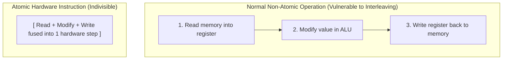
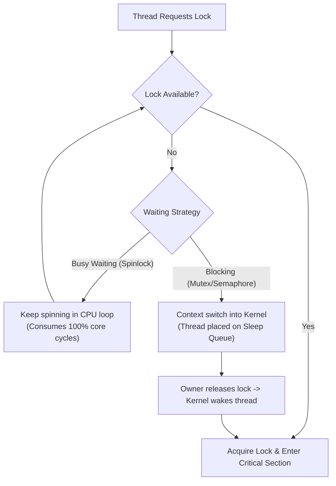

## Why Hardware Sync Exists

1. On real hardware, shared-variable operations do not behave as simply as theoretical models (such as [[3_Dekkers Algorithm]] or [[4_Petersons Algorithm]]) assume.
2. Compilers and modern out-of-order CPUs reorder memory reads and writes to maximize execution speed, which breaks software-only synchronization algorithms.
3. The missing piece is **atomicity**: an operation that executes as a single, un-interruptible step.
4. Hardware provides these indivisible instructions, and the operating system builds rich synchronization abstractions (such as mutexes and semaphores) on top of this hardware foundation.

---

## Atomic Instructions (The Read-Modify-Write Problem)

1. **Atomic** means indivisible. Other threads or processor cores cannot observe the operation in a half-completed state.
2. Most memory modifications are logically **Read-Modify-Write (RMW)** operations:
	1. **Read**: Load value from memory into a CPU register.
	2. **Modify**: Alter the register value in the ALU.
	3. **Write**: Store the updated value back into memory.
3. **The Interleaving Hazard**: If a context switch or another core's write occurs between the *Read* and the *Write*, both threads may read the same initial state and overwrite each other, causing a race condition where both believe they acquired a lock.
4. **Hardware Atomicity**: Hardware atomic instructions lock the memory bus or cache line during the RMW sequence, guaranteeing that all three steps behave as one single clock-cycle event.



---

## The 4 Core Atomic Primitives

### 1. Test-and-Set (The "Flag Grabbing" Metaphor)

- **Intuition**: Imagine a table with a flag. You run in, grab whatever flag is currently there, and immediately leave a `true` (busy flag) in its place:
  - If you picked up `false` (free): You were first! You now own the critical section.
  - If you picked up `true` (busy): Someone was already inside. You left the flag as `true` and must try again.
- **Why It Matters**: Testing the lock status and claiming the lock occur in **one indivisible grab**.

```c
// What the CPU executes indivisibly:
bool test_and_set(bool *target) {
    bool old_value = *target;
    *target = true; // Always set to true (occupied)
    return old_value; // Return the value BEFORE the set
}

// Building a basic Spinlock with Test-and-Set:
while (test_and_set(&lock) == true) {
    // If it was already true, keep spinning (busy waiting)
}
// --- Critical Section ---
lock = false; // Release lock
```

### 2. Compare-and-Swap / CAS (The "Optimistic Whiteboard" Metaphor)

- **Intuition**: Imagine a shared whiteboard displaying `100`. You want to add `5` to it:
  1. You look at the board and read `100`.
  2. You do the math in your head: `100 + 5 = 105`.
  3. When you go up to write `105`, you tell the hardware:
     > *"Only write 105 IF the board is STILL 100. If someone else changed it to 102 while I was calculating, abort and tell me the new value."*
- **Why It Matters**: This is the foundation of **lock-free data structures**. Instead of locking other threads out, a thread computes optimistically and simply retries if a conflict occurred.

```c
// What the CPU executes indivisibly:
int compare_and_swap(int *addr, int expected, int new_val) {
    int current = *addr;
    if (current == expected) {
        *addr = new_val; // Update only if unchanged
    }
    return current; // Returns value found at addr
}

// Lock-free atomic addition loop using CAS:
void atomic_add(int *addr, int value_to_add) {
    int current;
    do {
        current = *addr;
    } while (compare_and_swap(addr, current, current + value_to_add) != current);
}
```

### 3. Atomic Exchange / Swap (The "Handshake Trade" Metaphor)

- **Intuition**: You walk into a room holding a token labeled `1 (OCCUPIED)`. On the wall is a small slot box. In one blind, instant motion, you shove your token into the box and take whatever token was inside:
  - If you pulled out `0 (FREE)`: The room was empty! You now own the lock, and the box now holds `1`.
  - If you pulled out `1 (OCCUPIED)`: The room was already busy. The box still holds `1`, and you must retry later.

```c
// What the CPU executes indivisibly:
int atomic_exchange(int *addr, int new_val) {
    int old_val = *addr;
    *addr = new_val;
    return old_val;
}
```

### 4. Fetch-and-Add (The "Deli Ticket Dispenser" Metaphor)

- **Intuition**: The mechanical ticket dispenser at a bakery counter.
  - You pull a paper slip: you receive your ticket number (e.g., `#42`), and the counter mechanically rolls forward to `#43` in the exact same physical action.
  - Even if two people pull slips at the exact same instant, each receives a unique, ordered number.
- **Why It Matters**: Perfect for metrics counters, circular queues, and fair **Ticket Locks** (ordering threads by arrival sequence).

```c
// What the CPU executes indivisibly:
int fetch_and_add(int *addr, int increment) {
    int old_val = *addr;
    *addr = old_val + increment;
    return old_val;
}
```

---

## From Hardware Primitives to OS Primitives

A common confusion is conflating **Atomic Hardware Primitives** with **OS Mutexes and Semaphores**:

- An **Atomic Primitive** is a single **hardened steel bolt** provided by the CPU silicon. It operates on a single memory address in ~1 nanosecond and knows nothing about threads or queues.
- A **Mutex** or **Semaphore** is an entire **Bank Vault Door** built by the OS. It includes waiting rooms, sleep queues, and a scheduler. It is constructed *using* atomic bolts, but adds the ability to put threads to sleep.

| Dimension | Atomic Hardware Primitive | Mutex (Mutual Exclusion) | Semaphore |
| :--- | :--- | :--- | :--- |
| **Provided By** | **CPU Silicon** (Hardware instruction) | **OS Kernel & Thread Library** | **OS Kernel & Thread Library** |
| **Scope** | Single memory word (32/64-bit int) | Entire critical section (many lines of code) | Access to $N$ shared resources / signaling |
| **Execution Time** | **~1 nanosecond** (1 clock cycle) | Nanoseconds to Microseconds | Microseconds |
| **On Contention** | **Cannot sleep**: Spins or retries | **Puts thread to sleep** via OS scheduler | **Puts thread to sleep** if count $\le 0$ |
| **Ownership** | No concept of ownership | **Strict ownership**: Only locker can unlock | **No ownership**: Any thread can signal (`post`) |

### Common High-Level Primitives Built on Hardware Support

1. **Spinlocks**: Locks where waiting threads loop continuously (busy wait) until the atomic variable clears.
2. **Mutexes**: Mutual exclusion locks providing exclusive ownership, sleeping contending threads.
3. **Semaphores**: Signaling primitives maintaining an integer counter to regulate access across $N$ resources.
4. **Condition Variables**: Synchronization constructs that release an associated lock and put the calling thread to sleep until notified.
5. **Read-Write Locks**: Shared read access for multiple readers with exclusive access for a single writer.
6. **Barriers**: Coordination points where a group of threads must all arrive before any can proceed.
7. **Lock-Free Data Structures**: Concurrency algorithms that use atomic primitives (`CAS`) to update linked structures without locking.

---

## Busy Waiting vs. Blocking



1. **Busy Waiting (Spinning)**:
   - The thread stays active on the CPU core, repeatedly executing atomic test instructions in a tight loop.
   - **Advantage**: Zero latency when the lock is released (immediate pickup without a context switch).
   - **Disadvantage**: Burns CPU cycles, generates memory bus traffic, and drains battery power.
2. **Blocking (Sleeping)**:
   - The operating system deschedules the thread, changes its state to `BLOCKED`, and allocates the CPU core to another ready process.
   - **Advantage**: Frees the CPU core for useful work while waiting.
   - **Disadvantage**: Waking up incurs context-switch overhead (saving registers, kernel transitions, cache/TLB misses).
3. **The Trade-Off**: CPU consumption during spinning versus the latency cost of sleep and wake-up transitions.

---

## What Real Mutexes Do (The Hybrid / Futex Pattern)

Modern operating systems do not strictly choose only spinning or only sleeping; they combine both:

1. **The Rationale**:
   - If a critical section takes only 10 nanoseconds, putting the thread to sleep (costing thousands of nanoseconds) is wasteful.
   - If a critical section takes 10 milliseconds, spinning for millions of clock cycles is equally wasteful.
2. **The Hybrid Strategy**:
   - **Short Wait (Fast Path)**: The thread spins for a tiny threshold (e.g., a few hundred cycles). If the lock frees up, it acquires it instantly in user space without entering the kernel.
   - **Longer Wait (Slow Path)**: If the lock remains held, the thread stops spinning and tells the OS kernel to block it.
3. **Linux `futex` (Fast Userspace Mutex)**:
   - Uncontended lock acquisition takes the user-space fast path via a single atomic `CAS` instruction (no syscall).
   - Contended acquisition falls back to the `sys_futex` system call to suspend the thread in the kernel wait queue.
