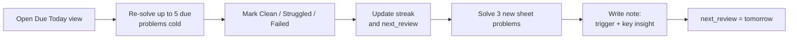

## DSA Framework

A simple daily system for working through Striver's 180 sheet in about 10 to 12 weeks, built on spaced revision.

---

### 0. The Improved Prompt

> I have been preparing DSA for a year and have solved about 350 problems (mostly Striver), but I still forget solutions and struggle with unseen problems. I am now doing Striver's 180 sheet on the TUF platform and keep notes in my `InterviewPrep` repo (Obsidian + VS Code, one note per problem from a template, tracked in `Problems.base`).
>
> Review my current DSA setup and propose a framework, in a single markdown file, that:
> 1. Fits a fixed daily routine I can follow every day, including bad days.
> 2. Has a revision schedule that shows exactly which problems are due today.
> 3. Builds pattern recognition so I can solve new problems, not just recall old ones.
> 4. Finishes the 180 sheet in about 2 months.
> 5. Uses only what I already have: TUF for submitting, Obsidian notes, frontmatter, and Bases/Dataview. No new tools.
>
> Research what people actually report on Reddit, LeetCode discuss and TUF before proposing, and cite sources. Keep it simple. Prefer fewer fields and fewer steps over completeness.

---

### 1. Why You Forget (Current Setup Review)

What already works:
- One note per problem with a fixed template.
- `pattern` and `SubPattern` links, plus pattern notes with "Recognition Cues".
- A `confidence` field and a Base table.

What is missing:
- **No schedule.** `confidence` records how you felt once, but nothing tells you *when* to look at a problem again. Without a due date, revision never happens.
- **Notes record the solution, not the insight.** The code is copied from TUF. What you need to remember is the one idea that unlocks the problem, and that is rarely written down.
- **Re-reading instead of re-solving.** Reading a solution feels like knowing it. Only solving it again from a blank editor proves it.
- **Pattern notes are not being fed.** Recognition Cues are written once and not updated as you solve more problems, so they never become your "how to spot it" guide.

Small bugs found:
- In [[Two Pointers]], the Dataview query uses `WHERE pattern = [[Two Pointers]]`. Problems store it in `SubPattern`, so the list is empty. It should be `WHERE SubPattern = [[Two Pointers]]`. The other subpattern notes have no problem list at all.
- [[Arrays]] starts with ` . # Recognition Cues`, which breaks the heading.

---

### 2. What the Research Says

What practitioners and prep guides agree on, and what it changed in this plan.

| Finding | Source | Effect on this plan |
| --- | --- | --- |
| Re-solve from a blank editor; re-reading gives a false sense of knowing | [DSA Tracker](https://dsatracker.tech/blog/how-to-revise-solved-dsa-problems), [redgreencode](https://www.redgreencode.com/leetcode-tip-11-how-to-use-spaced-repetition-part-1/) | Every review is a cold re-solve |
| Review intervals that roughly double (1, 3, 7, 21+ days) are the common pattern; no exact schedule is proven best | [redgreencode](https://www.redgreencode.com/leetcode-tip-10-planning-a-spaced-repetition-schedule/), [SpaceComplexity](https://spacecomplexity.ai/blog/how-many-leetcode-problems-to-solve) | Simple ladder: 1, 3, 7, 21 days |
| Three outcomes (clean, struggled, failed) are enough; retire a problem after 3 clean solves | [DSA Tracker](https://dsatracker.tech/blog/how-to-revise-solved-dsa-problems) | Replaced the 1-5 rating with 3 outcomes and a retire rule, so the review pile stops growing |
| Each review is a whole problem, so only a few fit per day | [redgreencode](https://www.redgreencode.com/leetcode-tip-13-spaced-repetition-interval-lengths/) | Daily review cap of 5 |
| Separate review spreadsheets and Anki decks get abandoned ("a second job") | [dev.to](https://dev.to/null_pointer/i-forgot-my-own-leetcode-solutions-after-10-days-so-i-built-this-k06) | Tracking lives in the note's frontmatter, nowhere else |
| Attempt for about 20 min, take a hint, try 10 more min, then read the solution | [dev.to](https://dev.to/alex_hunter_44f4c9ed6671e/why-am-i-not-making-progress-despite-solving-leetcode-daily-the-plateau-problem-28hk), [Tech Interview Handbook](https://www.techinterviewhandbook.org/coding-interview-prep/) | 20 + 10 minute rule for new problems |
| "Solved 300+ but can't solve new ones" comes from always knowing the pattern in advance. The fix is untagged practice: name the pattern before coding, explain aloud | [SpaceComplexity](https://spacecomplexity.ai/blog/how-many-leetcode-problems-to-solve), [dev.to](https://dev.to/alex_hunter_44f4c9ed6671e/why-am-i-not-making-progress-despite-solving-leetcode-daily-the-plateau-problem-28hk) | Sunday blind practice |
| Notes that help are one sentence: "Next time I see X, I'll try Y". Rewrite it if it didn't bring the approach back | [DSA Tracker](https://dsatracker.tech/blog/how-to-revise-solved-dsa-problems), [dev.to](https://dev.to/alex_hunter_44f4c9ed6671e/why-am-i-not-making-progress-despite-solving-leetcode-daily-the-plateau-problem-28hk) | Required `trigger` line, rewritten after a failed review |
| Cramming about 7 problems a day leads to not internalizing them | [Tech Interview Handbook](https://www.techinterviewhandbook.org/coding-interview-prep/) | 3 new per day, 2 on heavy review days |
| The 180 sheet is 179 problems in 17 modules | [TUF](https://takeuforward.org/prep-hub/strivers-180-master-dsa-patterns) | About 10 to 12 weeks at this pace |

Limits of this research:
- Reddit and TUF pages blocked fetching, so Reddit views come from search snippets only.
- Several sources sell study tools. Treat them as experience reports, not evidence.
- No source has real data on problems per day or exact intervals. Those numbers are reasonable defaults, not proven ones.

---

### 3. The System in One Picture



Two things every day: **revise what is due, then learn new problems.** Nothing else.

---

### 4. Frontmatter

```yaml
---
pattern: "[[Arrays]]"
SubPattern: "[[Two Pointers]]"
streak: 1
last_reviewed: 2026-11-03
next_review: 2026-11-10
trigger: "Water trapped between walls: process the shorter side, its running max is the level"
unique: false
link: https://takeuforward.org/...
tags:
  - striver180
---
```

| Field | Meaning |
| --- | --- |
| `streak` | Clean solves in a row (0 to 3). Replaces `confidence` |
| `last_reviewed` | Date of the last attempt |
| `next_review` | Date the problem is due again. Empty means retired |
| `trigger` | One line: "When I see X, I try Y" |

---

### 5. The Revision Rule (The Whole Algorithm)

After every review, pick one outcome:

| Outcome | What happened | `streak` | `next_review` |
| --- | --- | --- | --- |
| Failed | Needed the solution | 0 | Tomorrow |
| Struggled | Needed the trigger or a hint, took over 15 min, or had bugs | 0 | In 3 days |
| Clean | Optimal solution in 15 min or less, no help | +1 | In 7 days at streak 1, in 21 days at streak 2. At streak 3 the problem is **retired**: clear `next_review` |

- Failed: before moving on, rewrite the `trigger` and Key Insight so they would have brought the idea back.
- Retiring problems is what keeps the daily pile small. A problem that goes clean three times is learned.
- Failing a review is the system working. Those are exactly the problems you would have failed in an interview.

---

### 6. Daily Routine (About 2.5 to 3 Hours)

#### Step 1: Revise (Up to 75 min)

1. Open `Problems.base` and select the **Due Today** view.
2. For each due problem, oldest `next_review` first:
	1. Open it on TUF. **Do not open the note.**
	2. Solve it from a blank editor. Cap at 15 minutes.
	3. If stuck, read only the `trigger` line, then try again (this counts as Struggled).
	4. Run **Templater: Insert Templates/Review.md** and pick Clean, Struggled or Failed. It updates `streak`, `last_reviewed` and `next_review` for you.
3. **Cap: 5 reviews per day.** The rest roll over to tomorrow or Sunday.

#### Step 2: Learn New (75 to 90 min)

Take the next **3 problems** in sheet order. If more than 5 reviews were due today, take **2**.

1. Read the problem and work through one example by hand.
2. Before coding, write one line: which pattern you think it is and why.
3. Write the brute force idea and its complexity as a comment.
4. Try for the optimal solution for **20 minutes**.
5. Still stuck: read a hint (the intuition section only) and try **10 more minutes**.
6. Still stuck: read the solution, close it, and type it yourself from memory.
7. Submit on TUF.
8. Create the note from the template and fill in:
	- `trigger` (required)
	- **Key Insight**: the idea you missed or that made it click (required)
	- Brute force and optimal code, each with its TC and SC
	- Look out: edge cases and bugs you hit
9. Nothing to schedule: a note created in the Problems folder gets `streak: 0`, today's `last_reviewed` and tomorrow's `next_review` automatically.

#### Step 3: Close (5 min)

- If you finished a subpattern today, add one line to its **Recognition Cues** in the subpattern note.
- Commit (obsidian-git does this automatically).

#### Bad Day Rule

Short on time or energy? Do **Step 1 only**, even just 2 reviews. Cut new problems first, never reviews.

---

### 7. Weekly Routine (Sunday, About 2 Hours)

No new sheet problems on Sunday.

1. **Clear the review backlog** left over from the daily cap.
2. **Blind practice (60 min):** pick 2 unseen problems (LeetCode) from patterns you have finished, without looking at the tags.
	1. Name the pattern and say why before writing code.
	2. Explain your approach out loud as if in an interview.
	3. 30 minutes each, then check.
	4. Wrong pattern? Add the missed signal to that pattern note's Recognition Cues.
3. **Pattern review (20 min):** for each pattern you worked on this week, read only the `trigger` lines of its problems. Update the pattern note's Recognition Cues and Common Pitfalls.

---

### 8. The 10 to 12 Week Plan

- The sheet has 179 problems in 17 modules. 11 are done (`striver180` tag), so 168 remain.
- 3 new a day, 6 days a week = 18 per week, about 9 to 10 weeks if nothing else got in the way. But each new problem brings 3 reviews (after 1, 7 and 21 days), so from about week 2 most days have more than 5 due and you drop to 2 new problems. Expect **10 to 12 weeks** even if every review goes clean, and longer with failures. 2 months is only possible by dropping revision, which is the exact problem you are fixing.
- Expect 5 reviews plus 2 or 3 new problems on most days, and a bigger Sunday catch-up.
- On a light day (2 or fewer reviews due) you may do a 4th problem. Never do more.
- Follow the sheet's module order. Finish a module before starting the next, as similar problems back to back build recognition.

#### Problems You Already Solved Before

Many sheet problems are in your earlier 350. Do not skip them, treat them as a review:
- Solve cold with the 15 minute cap, no note open.
- Clean: write a short note (`trigger`, Key Insight, code), set `streak: 1` and `next_review` in 7 days.
- Otherwise: full note, handled as a new problem.

#### The Old 350

Leave them alone. Do not import or re-note them. The 180 sheet covers the important patterns.

---

### 9. Note Template

````markdown
---
pattern:
SubPattern:
streak: 0
last_reviewed:
next_review:
trigger:
unique: false
link:
tags:
  - striver180
---

## Question

### Example

---

## Key Insight

1. The one idea that makes the optimal solution work.
2. What I did not see the first time.

---

## Code

### Brute Force

```cpp

```

- TC: O(...)
- SC: O(...)

### Optimal 1

```cpp

```

- TC: O(...)
- SC: O(...)

---

## Look out

1. Edge cases and bugs I hit.
````

---

### 10. The Due Today View

Add this view to `Problems.base`:

```yaml
  - type: table
    name: Due Today
    filters:
      and:
        - next_review <= today()
    order:
      - file.name
      - SubPattern
      - streak
      - next_review
      - trigger
    sort:
      - property: next_review
        direction: ASC
```

It replaces the earlier `Review Queue` view. Retired problems have an empty `next_review`, so they drop out.

To log a review, open the problem note and run **Templater: Insert Templates/Review.md** (bind it to a hotkey). You can still edit the fields by hand in the table cells or the Properties panel.

---

### 11. Setup Status

Done:
- DSA Template uses `streak`, `last_reviewed`, `next_review`, `trigger` and has a Key Insight section.
- `Problems.base` has three views: **Due Today** (default), **Next 7 Days** and **All Problems**.
- `streak`, `last_reviewed` and `next_review` are typed as number and dates in Obsidian, so dates get a date picker.
- The 30 existing notes are scheduled from 2026-11-04 to 2026-11-16, weakest first. That is 2 a day, or 4 on Sundays, so new problems still fit under the cap of 5. Old confidence 4 or 5 starts at `streak: 1`, everything else at 0.
- Fixed the [[Two Pointers]] Dataview query and the [[Arrays]] heading.

Your part:
- Most old notes have an empty `trigger`. Fill it in the first time each one comes up for review.

---

### 12. Rules to Stick To

1. Revise before learning new.
2. Re-solve, never re-read.
3. Every note gets a `trigger` and a Key Insight.
4. Be honest about the outcome. A Struggled now beats a fake Clean that fails in the interview.
5. A bad day still has 2 reviews.
